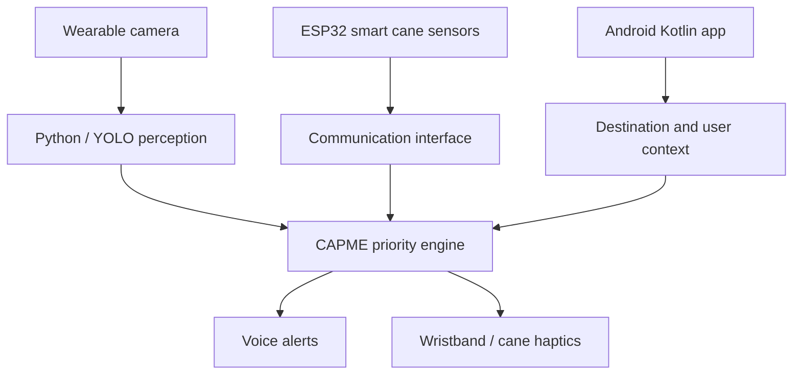

# NOVA architecture (draft)

**Deployment assumption:** Python perception/CAPME on Raspberry Pi, sensor firmware on ESP32, native Kotlin on Android. Transport choice and exact power topology remain design decisions.
